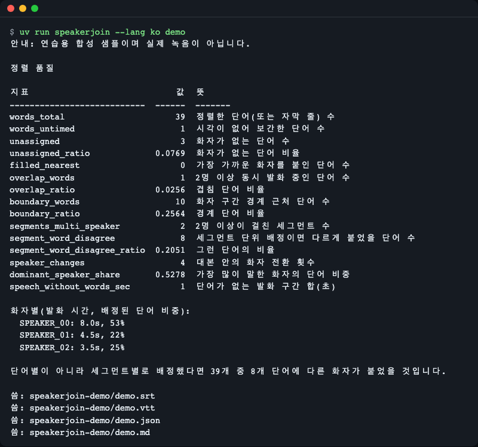
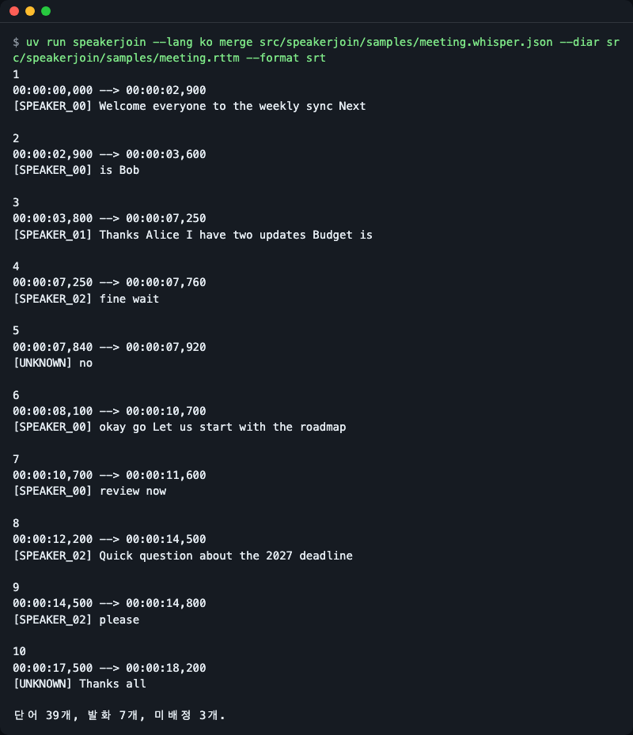
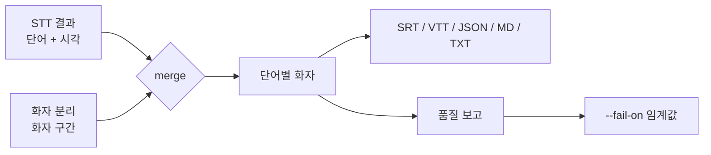
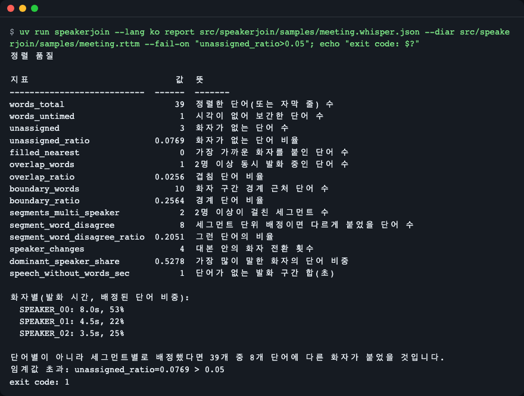

# speakerjoin

[English](README.md) | **한국어**

[](https://github.com/LeeGyeongPil/speakerjoin/actions/workflows/ci.yml)


음성 인식(STT) 결과와 별도의 화자 분리(diarization) 결과를 합쳐 화자별 대본·자막(SRT, WebVTT, JSON, Markdown, 텍스트)을 만들고, 정렬이 얼마나 믿을 만한지 수치로 알려 주는 라이브러리입니다. 파이썬 표준 라이브러리만 쓰고 런타임 의존성이 없으며, 파일만 있으면 되므로 오디오·모델·API 키가 필요 없습니다.



*내장 데모가 가상의 회의를 합치고 품질 수치를 출력한 화면입니다. 39단어 중 3단어는 화자가 없고, 세그먼트 단위로 화자를 붙이면 8단어의 화자가 달라집니다.*

## 설치

```bash
uv add git+https://github.com/LeeGyeongPil/speakerjoin
```

프로젝트에 설치하지 않고 clone 해서 바로 써 볼 수도 있습니다.

```bash
git clone https://github.com/LeeGyeongPil/speakerjoin
cd speakerjoin
uv run speakerjoin demo
```

Python 3.10 이상이 필요합니다. 런타임 의존성은 없습니다. [uv](https://docs.astral.sh/uv/) 설치: `curl -LsSf https://astral.sh/uv/install.sh | sh`.

## 빠르게 시작하기

내장 가상 샘플(faster-whisper 형식 대본과 RTTM 화자 파일)을 합쳐 누가 무슨 말을 했는지 출력합니다.

```python
from importlib.resources import files

import speakerjoin as sj

samples = files("speakerjoin").joinpath("samples")
transcript = sj.load_transcript(
    samples.joinpath("meeting.whisper.json").read_text(encoding="utf-8")
)
diarization = sj.load_diarization(samples.joinpath("meeting.rttm").read_text(encoding="utf-8"))

result = sj.merge(transcript, diarization)
print(result.report.words_total, result.report.unassigned, result.report.segment_word_disagree)
print(sj.to_text(result), end="")
```

```text
39 3 8
SPEAKER_00: Welcome everyone to the weekly sync Next is Bob
SPEAKER_01: Thanks Alice I have two updates Budget is
SPEAKER_02: fine wait
UNKNOWN: no
SPEAKER_00: okay go Let us start with the roadmap review now
SPEAKER_02: Quick question about the 2027 deadline please
UNKNOWN: Thanks all
```

첫 줄은 단어 39개, 화자 없는 단어 3개, 세그먼트 단위 배정이었다면 화자가 달라질 단어 8개라는 뜻입니다. `UNKNOWN` 은 어떤 화자 구간에도 들지 않는 단어입니다. (예시 문장은 영어 샘플 그대로입니다.)

같은 작업을 명령줄에서 하면서 화자 이름을 바꿔 자막 파일로 씁니다.

```bash
uv run speakerjoin merge src/speakerjoin/samples/meeting.whisper.json \
  --diar src/speakerjoin/samples/meeting.rttm -o out.vtt \
  --speaker-map SPEAKER_00=Alice --speaker-map SPEAKER_01=Bob
```

```text
39 words, 7 utterances, unassigned 3.
```

요약 줄은 stderr 로 나가고(로케일이 한국어면 자동으로 한국어, `--lang en|ko` 로 고를 수 있음), `out.vtt` 는 다음처럼 시작합니다.

```text
WEBVTT

00:00:00.000 --> 00:00:02.900
<v Alice>Welcome everyone to the weekly sync Next

00:00:02.900 --> 00:00:03.600
<v Alice>is Bob

00:00:03.800 --> 00:00:07.250
<v Bob>Thanks Alice I have two updates Budget is
```



*화자별 SRT. 한 대본 세그먼트 한가운데서 화자가 바뀌어도 그 자리에서 자막이 나뉩니다("Next" / "is Bob" 은 Alice, "Thanks Alice" 부터 Bob).*

회의록에는 `--format md` 가 편합니다. 화자별로 단어를 묶고 시작 시각을 붙입니다(`uv run speakerjoin merge ... --format md`, 아래는 영어 화면 기준 출력의 앞부분).

```text
# Transcript

**SPEAKER_00** [0:00:00]

Welcome everyone to the weekly sync Next is Bob

**SPEAKER_01** [0:00:03]

Thanks Alice I have two updates Budget is

**SPEAKER_02** [0:00:07]

fine wait
```

(출력의 앞부분입니다. 나머지 화자 구간이 이어집니다. `--lang ko` 에서는 제목이 "대본"입니다.)

## 지원 형식

시각은 모두 초 단위로 바뀝니다. 형식을 강제하려면 `--stt-format` / `--diar-format`(파이썬에서는 `format=`)을 쓰고, 아니면 데이터 모양으로 자동 감지합니다. 이름 목록은 `speakerjoin formats` 로 볼 수 있습니다.

**음성 인식(STT) 입력** (`load_transcript`)

| 형식 | 만드는 곳 | 필요한 모양 | 단어 시각 |
|---|---|---|---|
| `faster_whisper` | [faster-whisper](https://github.com/SYSTRAN/faster-whisper) 세그먼트를 직접 JSON 으로 저장한 것(자체 JSON 출력이 없음) | `{"segments": [{"start", "end", "text", "words": [{"word", "start", "end", "probability"}]}]}` | `word_timestamps=True` 로 돌렸을 때 있음 |
| `whisperx` | 정렬(align) 이후의 [WhisperX](https://github.com/m-bain/whisperX) 결과 | 같은 `segments[].words[]`, `probability` 대신 `score`. 정렬 안 된 단어(숫자 등)는 `start` 가 없을 수 있고 보간됩니다 | 있음 |
| `openai_verbose` | OpenAI 전사, `response_format="verbose_json"` | `{"segments": [...], "words": [{"word", "start", "end"}]}`. 단어는 최상위 목록입니다 | 단어 타임스탬프를 요청했을 때만 |
| `openai_diarized` | OpenAI 화자 분리 전사 | `{"segments": [{"start", "end", "text", "speaker"}]}` | 없음(세그먼트 단위) |
| `deepgram` | Deepgram 응답 | `results.channels[0].alternatives[0].words[]` | 있음 |
| `assemblyai` | AssemblyAI 전사 JSON | `utterances[]` 또는 최상위 `words[]`, 시각은 **밀리초** | 있음 |
| `srt`, `vtt` | 모든 자막 파일 | 큐. WebVTT 의 `<v 이름>` 음성 태그는 화자로 읽습니다 | 없음(큐 하나가 한 단위) |

**화자 분리 입력** (`load_diarization`)

| 형식 | 만드는 곳 | 필요한 모양 | 참고 |
|---|---|---|---|
| `rttm` | pyannote(`write_rttm`) 등 대부분의 화자 분리 도구 | `SPEAKER file 1 START DURATION <NA> <NA> speaker <NA> <NA>` 줄 | 5번째 열은 끝이 아니라 **길이**입니다. 한 파일에 녹음이 여럿이면 `--file-id` |
| `pyannoteai` | pyannoteAI 작업 결과 | `output.diarization[]`, 선택으로 `output.exclusiveDiarization[]`, 항목 `{start, end, speaker}` | 배타 목록(겹치는 화자 없음)을 우선 씁니다. `--no-prefer-exclusive` 는 일반 목록 |
| `json` | 직접 만든 어떤 것 | `{"start": 0.0, "end": 2.2, "speaker": "alice"}` 의 목록 또는 `{"turns": [...]}` | 초 단위 |
| 파이썬 객체 | 코드에서만 | `(start, end, speaker)` 튜플 또는 pyannote `Annotation` | |

주의: STT 파일에 단어 시각이 없으면(단어 타임스탬프 없이 요청한 OpenAI `verbose_json`, 자막 파일) `unit="auto"` 는 조용히 세그먼트당 화자 하나로 배정합니다. 이 경우는 보고서 JSON 의 `effective_unit`(`word`, `segment`, `mixed`)에 남고, CLI 는 stderr 에 한 줄을 출력합니다.

```text
안내: 단어 시각을 찾지 못해 세그먼트 단위로 화자를 배정했습니다. 단어 단위 결과가 필요하면 받아쓰기 도구에서 단어 타임스탬프를 요청하세요.
```

(`words` 목록이 없는 verbose_json 파일과 일반 `json` 구간 파일에 `speakerjoin --lang ko merge` 를 실행한 출력입니다. 영어 화면에서는 `Note: no word timing found, ...`.)

## 입력 파일 만들기

입력 파일을 만드는 스케치입니다. 이 저장소의 테스트로 실행하지 않았고, 각자의 패키지가 필요하며(pyannote 는 모델 내려받기와 CPU 에서 수 분이 걸릴 수 있음), 설치한 버전에 맞게 고쳐야 할 수 있습니다.

faster-whisper 를 위 JSON 모양으로 저장([문서](https://github.com/SYSTRAN/faster-whisper), 2026-11-14 확인):

```python
import json

from faster_whisper import WhisperModel

model = WhisperModel("small")
segments, _info = model.transcribe("meeting.wav", word_timestamps=True)
data = {
    "segments": [
        {
            "start": s.start,
            "end": s.end,
            "text": s.text,
            "words": [
                {"word": w.word, "start": w.start, "end": w.end, "probability": w.probability}
                for w in s.words
            ],
        }
        for s in segments
    ]
}
with open("meeting.whisper.json", "w", encoding="utf-8") as f:
    json.dump(data, f, ensure_ascii=False)
```

pyannote.audio 를 RTTM 으로 저장([문서](https://github.com/pyannote/pyannote-audio), 2026-11-14 확인). 4 버전은 `exclusive_speaker_diarization`(겹침 없음)을 가진 객체를 돌려주며 합치기에는 이쪽을 권장합니다. 이전 버전은 `Annotation` 을 바로 돌려주고, `load_diarization` 은 `Annotation` 도 받습니다.

```python
from pyannote.audio import Pipeline

pipeline = Pipeline.from_pretrained("pyannote/speaker-diarization-community-1")
output = pipeline("meeting.wav")
with open("meeting.rttm", "w", encoding="utf-8") as f:
    output.exclusive_speaker_diarization.write_rttm(f)
```

OpenAI: 결과가 단어 단위로 남도록 단어 타임스탬프를 요청([API 레퍼런스](https://developers.openai.com/api/reference/resources/audio), 2026-11-14 확인):

```python
import json

from openai import OpenAI

client = OpenAI()
with open("meeting.wav", "rb") as audio:
    result = client.audio.transcriptions.create(
        model="whisper-1",
        file=audio,
        response_format="verbose_json",
        timestamp_granularities=["word", "segment"],
    )
with open("meeting.openai.json", "w", encoding="utf-8") as f:
    json.dump(result.model_dump(), f, ensure_ascii=False)
```

그다음: `uv run speakerjoin merge meeting.openai.json --diar meeting.rttm -o meeting.srt`.

## 핵심 개념



- **대본(Transcript)**: 무슨 말을 했는지와 시각. 세그먼트 안에 단어가 있고, 형식에 따라(SRT·VTT·OpenAI diarized JSON) 단어 시각이 없어 세그먼트가 가장 작은 단위입니다.
- **화자 분리(Diarization)**: 누가 언제 말했는지를 화자 구간(turn)으로 나타낸 것. 서로 다른 화자의 구간은 겹칠 수 있습니다.
- **배정(Assignment)**: 단어와 가장 오래 겹치는 구간의 화자를 붙입니다(`strategy="overlap"`). 단어 중점 시각에 활성인 화자를 붙이는 `"midpoint"` 도 있습니다. 단어 시각이 없으면 세그먼트 전체로 물러납니다(`unit="auto"`).
- **품질 보고**: 결과를 믿어도 되는지 알려 주는 수치입니다. 아래 표를 보세요.

| 지표 | 뜻 |
|---|---|
| `unassigned_ratio` | 어떤 화자 구간에도 들지 않은 단어의 비율 |
| `overlap_ratio` | 2명 이상이 동시에 말하는 동안 나온 단어의 비율 |
| `boundary_ratio` | 시작 또는 끝이 화자 구간 가장자리 `tolerance`(0.2초) 안에 있어 화자가 틀리기 쉬운 단어의 비율 |
| `segment_word_disagree` | 세그먼트 전체를 한 화자로 붙였다면 다른 화자가 붙었을 단어 수 |
| `speech_without_words_sec` | STT 가 단어를 내지 않은 화자 구간의 길이(초) |

나머지 필드는 `speakerjoin report` 출력(다음 절 스크린샷)에 있습니다.

### 배정 방식

1. 화자 구간을 시작 시각순으로 정렬하고, 단어를 시간 순서로 훑으면서 각 단어 근처에서 활성인 구간만 살펴봅니다. 단어 20,000개 × 구간 2,000개도 빠릅니다.
2. 길이가 0인 단어(일부 도구는 `start == end` 를 냄)는 중심을 맞춰 `min_word_dur`(0.02초)로 넓혀(`zero_length` 표시) 구간과 겹칠 수 있게 합니다.
3. 시각이 전혀 없는 단어는 버리지 않고 앞뒤 단어 사이에 고르게 놓습니다(`interpolated` 표시).
4. 겹침 합이 가장 큰 화자가 이깁니다. 동률이면 먼저 시작한 구간의 화자입니다. 어떤 구간에도 들지 않으면 `UNKNOWN`(JSON 에서는 `null`)이고, `fill_nearest=True` 면 가장 가까운 화자를 붙입니다.
5. 단어 시각이 없으면 세그먼트 전체가 한 단위입니다.

### WhisperX 와의 차이

[WhisperX](https://github.com/m-bain/whisperX) 에도 비슷한 함수 `assign_word_speakers` 가 있습니다(단어별 최대 겹침, 선택적 최근접 채우기, 소스 2026-11-14 확인). speakerjoin 은 바로 대체하는 도구가 아니고, 차이는 입력과 보고 쪽에 있습니다. pandas DataFrame 과 WhisperX 자체 결과 대신 RTTM·pyannoteAI JSON·자막·다른 서비스의 JSON 을 바로 읽고, 시작 시각이 없는 단어를 화자 없이 두지 않고 보간하며, 길이 0 단어를 넓히고, 위의 수치를 돌려줍니다. 둘 다 "최대 겹침" 이라는 같은 생각을 쓰는 곳에서는 결과가 비슷할 것으로 보지만, 이 저장소는 WhisperX 와 대조 테스트를 하지 않습니다.

## API

모든 이름은 `speakerjoin` 에서 가져올 수 있습니다.

| 이름 | 하는 일 | 주요 인자 | 반환 |
|---|---|---|---|
| `load_transcript(src, *, format="auto")` | 경로·텍스트·파싱된 JSON dict 에서 STT 결과를 읽음 | `format`: `openai_verbose`, `openai_diarized`, `faster_whisper`, `whisperx`, `deepgram`, `assemblyai`, `srt`, `vtt` | `Transcript` |
| `load_diarization(src, *, format="auto", file_id=None, prefer_exclusive=True)` | 경로·텍스트·파싱된 JSON·`(start, end, speaker)` 튜플·pyannote `Annotation` 에서 화자 구간을 읽음 | `format`: `rttm`, `pyannoteai`, `json`; 녹음이 여러 개인 RTTM 은 `file_id` | `Diarization` |
| `merge(transcript, diarization, *, strategy="overlap", unit="auto", fill_nearest=False, tolerance=0.2, min_word_dur=0.02)` | 모든 단어에 화자를 붙이고 보고서를 계산 | `strategy`: `overlap` 또는 `midpoint`; `unit`: `auto`, `word`, `segment`; `fill_nearest` 는 구간 밖 단어에 가장 가까운 화자를 붙임 | `MergeResult` (`words`, `utterances`, `report`, `options`) |
| `to_srt`, `to_vtt`, `to_json`, `to_markdown`, `to_text` | `MergeResult` 를 출력 형식으로 만듦 | `speaker_map`(화자 이름 바꾸기), `max_chars=42`, `max_duration=7.0` (`to_markdown` 은 `title` 도 받음) | `str` |
| `check_thresholds(report, exprs)` | `"unassigned_ratio>0.05"` 같은 식을 평가 | 숫자인 `Report` 지표 이름; 연산자 `> >= < <=` | 넘은 임계값마다 메시지 하나인 리스트(비어 있으면 모두 통과); 식이 틀렸거나 모르는 지표면 `ThresholdSyntaxError` |
| `detect_format(data, *, label=...)` | 파싱된 입력 또는 텍스트의 형식 이름을 알려 줌 | 텍스트 또는 파싱된 JSON | 형식 이름 |
| `Report` | 수치 보고서. JSON 은 `to_dict()`, 숫자 지표만은 `metrics()` | | |
| `Word`, `Segment`, `Transcript`, `Turn`, `Diarization`, `AssignedWord`, `Utterance`, `MergeResult` | 변경 불가 dataclass | | |
| `SpeakerJoinError` | 의도해서 던지는 모든 오류의 부모 클래스 | | |
| `UnknownFormatError`, `FormatError`, `ThresholdSyntaxError` | 알 수 없는 입력 모양, 내용 오류, 잘못된 `--fail-on` 식 | | |

`merge` 는 모르는 `strategy`·`unit`, 0 이하의 `min_word_dur`, 음수 `tolerance` 에 `ValueError` 를 냅니다.

`result.words[i].flags` 의 표시: `unassigned`, `filled_nearest`, `overlap`, `boundary`, `interpolated`(시작 시각이 없어 이웃 단어 사이에 배치), `zero_length`(`min_word_dur` 폭으로 넓힘).

## CLI

```text
speakerjoin merge  STT --diar FILE [-o FILE] [--format srt|vtt|json|md|txt] [--report FILE]
speakerjoin report STT --diar FILE [--fail-on EXPR]... [--json]
speakerjoin demo   [--out DIR]
speakerjoin formats
```

`merge` 와 `report` 는 `--stt-format`, `--diar-format`, `--file-id`, `--no-prefer-exclusive`, `--strategy`, `--unit`, `--fill-nearest`, `--tolerance`, `--min-word-dur` 도 받고, `merge` 는 `--speaker-map OLD=NEW`, `--max-chars`, `--max-duration` 도 받습니다. 전체 목록은 `speakerjoin merge --help`. 종료 코드: 0 정상, 1 `--fail-on` 임계값 초과, 2 잘못된 입력·인자.

## 화면 언어

화면 언어: `--lang en|ko`, 다음으로 환경 변수 `SPEAKERJOIN_LANG`, 그다음 `LC_ALL`, `LC_MESSAGES`, `LANG` 순이며 한국어가 아니면 영어입니다. JSON 보고서의 키는 항상 영어입니다.

## 사용 예

### 정렬이 나쁘면 파이프라인 실패시키기

```bash
uv run speakerjoin report src/speakerjoin/samples/meeting.whisper.json \
  --diar src/speakerjoin/samples/meeting.rttm --fail-on "unassigned_ratio>0.05"
```

품질 표가 아래 스크린샷처럼 출력된 뒤 다음 줄이 나옵니다.

```text
Threshold exceeded: unassigned_ratio=0.0769 > 0.05
```

종료 코드는 1 입니다(`--lang ko` 에서는 앞머리가 한국어). 스크린샷은 명령 뒤에 `; echo "exit code: $?"` 를 붙여 종료 코드가 화면에 보이게 했습니다. `--fail-on "unassigned_ratio>0.5"` 로 바꾸면 0 으로 끝납니다.



*`--fail-on` 은 숫자 지표 이름이면 무엇이든 받고 여러 번 쓸 수 있습니다. CI 관문으로 쓰세요.*

### 메모리 안의 데이터: 자막 + `(start, end, speaker)` 튜플

```python
import speakerjoin as sj

srt = """1
00:00:00,000 --> 00:00:02,000
Hello there.

2
00:00:02,500 --> 00:00:04,000
Hi, how are you?
"""
turns = [(0.0, 2.2, "alice"), (2.3, 4.2, "bob")]

result = sj.merge(sj.load_transcript(srt, format="srt"), sj.load_diarization(turns))
print(sj.to_text(result), end="")
print(sj.detect_format(srt))
```

```text
alice: Hello there.
bob: Hi, how are you?
srt
```

pyannote `Annotation` 도 같은 방식으로 `load_diarization` 에 넘길 수 있습니다. 이 라이브러리는 pyannote 를 import 하지 않습니다.

### 단어와 표시 살펴보기

```python
from importlib.resources import files

import speakerjoin as sj

s = files("speakerjoin").joinpath("samples")
result = sj.merge(
    sj.load_transcript(s.joinpath("meeting.whisper.json").read_text(encoding="utf-8")),
    sj.load_diarization(s.joinpath("meeting.rttm").read_text(encoding="utf-8")),
)
for w in result.words[:12]:
    print(f"{w.word.text.strip():10} {str(w.speaker):11} {sorted(w.flags)}")
print(result.report.to_dict()["word_share"])
```

```text
Welcome    SPEAKER_00  ['boundary']
everyone   SPEAKER_00  []
to         SPEAKER_00  []
the        SPEAKER_00  []
weekly     SPEAKER_00  []
sync       SPEAKER_00  []
Next       SPEAKER_00  []
is         SPEAKER_00  []
Bob        SPEAKER_00  []
Thanks     SPEAKER_01  ['boundary']
Alice      SPEAKER_01  []
I          SPEAKER_01  []
{'SPEAKER_00': 0.527778, 'SPEAKER_01': 0.222222, 'SPEAKER_02': 0.25}
```

### 알 수 없는 입력

```python
import speakerjoin as sj

try:
    sj.load_transcript({"hello": "world"})
except sj.UnknownFormatError as err:
    print(type(err).__name__, err.supported[:3])
```

```text
UnknownFormatError ('openai_verbose', 'openai_diarized', 'faster_whisper')
```

CLI 는 트레이스백 대신 한 줄 오류를 출력하고 종료 코드 2 로 끝납니다.

## 언제 쓰나

- 잘 맞는 경우: STT 파일과 화자 분리 파일이 이미 있고, 화자별 자막·대본과 "어디가 불안한지" 알려 주는 수치가 필요할 때.
- 잘 맞는 경우: 튜토리얼의 "단어에 화자 붙이기" 코드를 매번 복사하고 형식마다 파서를 새로 쓰는 일을 그만두고 싶을 때.
- 다른 도구: 인식이나 화자 분리 모델 자체를 돌리려면 [WhisperX](https://github.com/m-bain/whisperX), [pyannote.audio](https://github.com/pyannote/pyannote-audio) 또는 쓰는 STT 서비스를 쓰세요. speakerjoin 은 그 결과물만 다룹니다.
- 다른 도구: 정답 라벨과 비교해 화자 분리 점수(DER)를 내려면 [pyannote.metrics](https://github.com/pyannote/pyannote-metrics). speakerjoin 의 보고서는 정답이 필요 없습니다.

## 한계

- Deepgram·AssemblyAI 의 단어→세그먼트 묶음은 문장 부호·1초 간격·40단어 기준의 휴리스틱입니다. AssemblyAI 는 `utterances` 가 있으면 그것을 씁니다.
- 경계·겹침 판단은 시각 정확도(약 0.3초 오차)에 민감합니다. `tolerance` 로 조절하세요.
- 세그먼트 수준 입력(SRT·VTT·OpenAI diarized JSON)은 자막 한 줄이 한 단위라 `segment_word_disagree` 는 0 입니다.
- 데모 샘플은 손으로 만든 가상 데이터이며 실제 녹음이 아닙니다.
- "입력 파일 만들기"의 스케치는 외부 패키지에 의존하며 여기서 테스트하지 않습니다.

## 감사의 말

최대 겹침 아이디어는 WhisperX(BSD-2-Clause)와 pyannote 프로젝트(MIT)를 따르고, pyannoteAI 합치기 튜토리얼은 배타 화자 분리를 권장합니다. 이 라이브러리에 그쪽 코드는 들어 있지 않습니다. 출처: [WhisperX](https://github.com/m-bain/whisperX), [pyannote.audio](https://github.com/pyannote/pyannote-audio), [pyannoteAI 튜토리얼](https://docs.pyannote.ai/tutorials/diarization-asr-merge) (2026-11-14 확인).

## 버전·호환성

유의적 버전(SemVer)을 따릅니다. 0.x 동안은 마이너 버전에서 API 가 바뀔 수 있고, 바뀌면 [CHANGELOG.md](CHANGELOG.md)에 적습니다.

## 개발·기여

```bash
uv sync
uv run pytest -q
uv run ruff check
uv build
```

## 라이선스

MIT.
