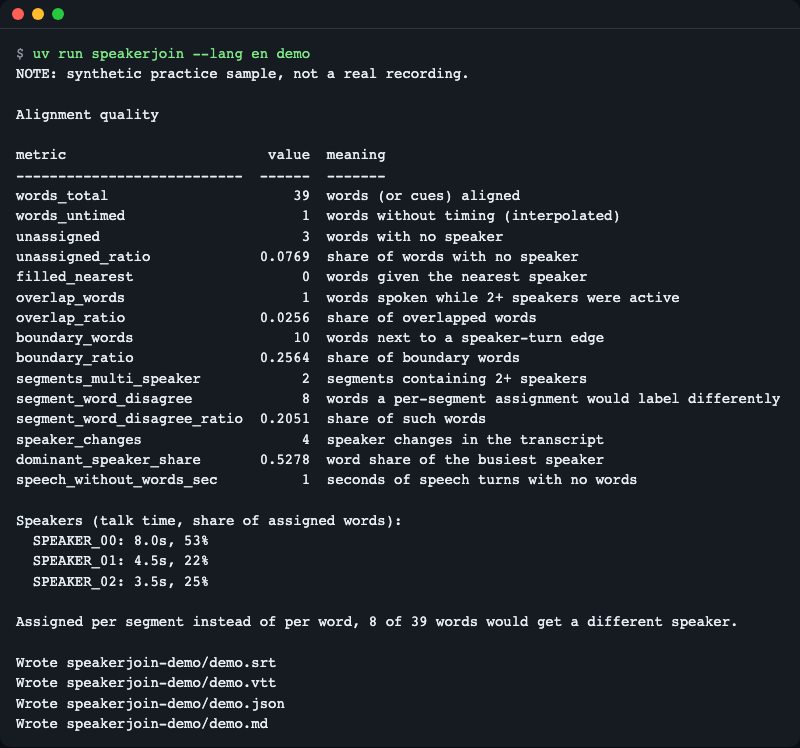
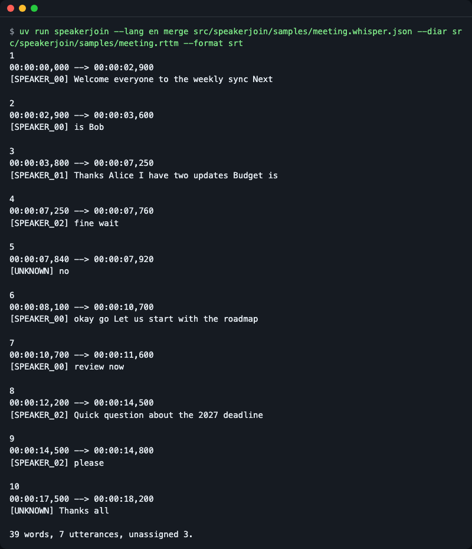
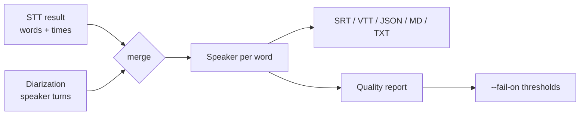
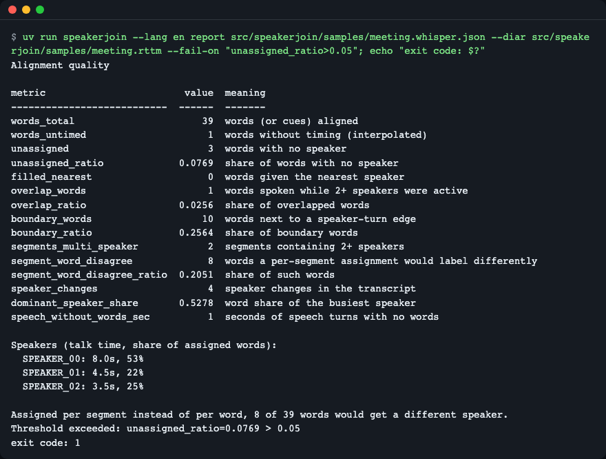

# speakerjoin

**English** | [한국어](README.ko.md)

[](https://github.com/LeeGyeongPil/speakerjoin/actions/workflows/ci.yml)


Join a speech-to-text result and a separate speaker diarization result into speaker-labelled transcripts and subtitles (SRT, WebVTT, JSON, Markdown, text), and measure how trustworthy the alignment is. Pure Python standard library, no runtime dependencies, and it works on files, so you need no audio, model or API key.



*The built-in demo merges a synthetic meeting and prints the quality numbers: 3 of 39 words got no speaker, and 8 words would have a different speaker if you assigned speakers per segment instead of per word.*

## Install

```bash
uv add git+https://github.com/LeeGyeongPil/speakerjoin
```

Or use it from a clone without installing it into a project:

```bash
git clone https://github.com/LeeGyeongPil/speakerjoin
cd speakerjoin
uv run speakerjoin demo
```

Needs Python 3.10 or newer. Runtime dependencies: none. To install [uv](https://docs.astral.sh/uv/): `curl -LsSf https://astral.sh/uv/install.sh | sh`.

## Quick start

Merge the bundled synthetic sample (a faster-whisper style transcript and an RTTM speaker file) and print who said what:

```python
from importlib.resources import files

import speakerjoin as sj

samples = files("speakerjoin").joinpath("samples")
transcript = sj.load_transcript(
    samples.joinpath("meeting.whisper.json").read_text(encoding="utf-8")
)
diarization = sj.load_diarization(samples.joinpath("meeting.rttm").read_text(encoding="utf-8"))

result = sj.merge(transcript, diarization)
print(result.report.words_total, result.report.unassigned, result.report.segment_word_disagree)
print(sj.to_text(result), end="")
```

```text
39 3 8
SPEAKER_00: Welcome everyone to the weekly sync Next is Bob
SPEAKER_01: Thanks Alice I have two updates Budget is
SPEAKER_02: fine wait
UNKNOWN: no
SPEAKER_00: okay go Let us start with the roadmap review now
SPEAKER_02: Quick question about the 2027 deadline please
UNKNOWN: Thanks all
```

The first line reads: 39 words, 3 without a speaker, 8 whose speaker would change under per-segment assignment. `UNKNOWN` marks words that fall outside every speaker turn.

The same thing from the command line, writing a subtitle file with renamed speakers:

```bash
uv run speakerjoin merge src/speakerjoin/samples/meeting.whisper.json \
  --diar src/speakerjoin/samples/meeting.rttm -o out.vtt \
  --speaker-map SPEAKER_00=Alice --speaker-map SPEAKER_01=Bob
```

```text
39 words, 7 utterances, unassigned 3.
```

The summary line goes to stderr; `out.vtt` starts like this:

```text
WEBVTT

00:00:00.000 --> 00:00:02.900
<v Alice>Welcome everyone to the weekly sync Next

00:00:02.900 --> 00:00:03.600
<v Alice>is Bob

00:00:03.800 --> 00:00:07.250
<v Bob>Thanks Alice I have two updates Budget is
```



*Speaker-labelled SRT. A new cue starts at every speaker change, even in the middle of one transcript segment ("Next" / "is Bob" stay with Alice, "Thanks Alice" starts Bob).*

For meeting notes, `--format md` groups the words by speaker with a start time (`uv run speakerjoin merge ... --format md`):

```text
# Transcript

**SPEAKER_00** [0:00:00]

Welcome everyone to the weekly sync Next is Bob

**SPEAKER_01** [0:00:03]

Thanks Alice I have two updates Budget is

**SPEAKER_02** [0:00:07]

fine wait
```

(The first lines of the output; the full text continues with the remaining speaker turns.)

## Supported formats

Times are converted to seconds everywhere. Use `--stt-format` / `--diar-format` (or `format=` in Python) to force a format; otherwise it is detected from the shape of the data. `speakerjoin formats` lists the names.

**Speech-to-text input** (`load_transcript`)

| Format | Produced by | Required shape | Word times |
|---|---|---|---|
| `faster_whisper` | your own JSON dump of [faster-whisper](https://github.com/SYSTRAN/faster-whisper) segments (it has no native JSON output) | `{"segments": [{"start", "end", "text", "words": [{"word", "start", "end", "probability"}]}]}` | yes, if run with `word_timestamps=True` |
| `whisperx` | [WhisperX](https://github.com/m-bain/whisperX) result after alignment | same `segments[].words[]`, with `score` instead of `probability`; unaligned words (e.g. numbers) may lack `start` and are interpolated | yes |
| `openai_verbose` | OpenAI transcription with `response_format="verbose_json"` | `{"segments": [...], "words": [{"word", "start", "end"}]}`; the words are a top-level list | only if you request word timestamps |
| `openai_diarized` | OpenAI diarized transcription | `{"segments": [{"start", "end", "text", "speaker"}]}` | no, segment level |
| `deepgram` | Deepgram response | `results.channels[0].alternatives[0].words[]` | yes |
| `assemblyai` | AssemblyAI transcript JSON | `utterances[]` or top-level `words[]`; times in **milliseconds** | yes |
| `srt`, `vtt` | any subtitle file | cues; WebVTT `<v Name>` voice tags are read as speakers | no, one cue is one unit |

**Diarization input** (`load_diarization`)

| Format | Produced by | Required shape | Notes |
|---|---|---|---|
| `rttm` | pyannote (`write_rttm`), most diarization tools | lines `SPEAKER file 1 START DURATION <NA> <NA> speaker <NA> <NA>` | column 5 is the **duration**, not the end; pass `--file-id` when one file holds several recordings |
| `pyannoteai` | pyannoteAI job result | `output.diarization[]` and optionally `output.exclusiveDiarization[]`, items `{start, end, speaker}` | the exclusive list (no overlapping speakers) is preferred; `--no-prefer-exclusive` uses the plain one |
| `json` | anything you write yourself | a list, or `{"turns": [...]}`, of `{"start": 0.0, "end": 2.2, "speaker": "alice"}` | seconds |
| Python objects | in code only | `(start, end, speaker)` tuples, or a pyannote `Annotation` | |

Pitfall: if the speech-to-text file has no word times (an OpenAI `verbose_json` request without word timestamps, subtitles), `unit="auto"` silently assigns one speaker per segment. Mixed or fallback runs are recorded as `effective_unit` (`word`, `segment` or `mixed`) in the report JSON, and the CLI prints one line on stderr:

```text
Note: no word timing found, so speakers were assigned per segment. Request word timestamps from your speech-to-text tool for word-level results.
```

(Output of `speakerjoin merge` on a verbose_json file without a `words` list and a plain `json` turn file.)

## Producing inputs

Sketches for making the input files. They are not run by this repository's tests, need their own packages (and, for pyannote, a model download that can take minutes on a CPU), and may need adjusting to the versions you install.

faster-whisper, written to the JSON shape above ([docs](https://github.com/SYSTRAN/faster-whisper), checked 2026-11-14):

```python
import json

from faster_whisper import WhisperModel

model = WhisperModel("small")
segments, _info = model.transcribe("meeting.wav", word_timestamps=True)
data = {
    "segments": [
        {
            "start": s.start,
            "end": s.end,
            "text": s.text,
            "words": [
                {"word": w.word, "start": w.start, "end": w.end, "probability": w.probability}
                for w in s.words
            ],
        }
        for s in segments
    ]
}
with open("meeting.whisper.json", "w", encoding="utf-8") as f:
    json.dump(data, f, ensure_ascii=False)
```

pyannote.audio, written as RTTM ([docs](https://github.com/pyannote/pyannote-audio), checked 2026-11-14). Version 4 returns an object whose `exclusive_speaker_diarization` has no overlaps and is the recommended input for joining; older versions return the `Annotation` directly, and `load_diarization` also accepts an `Annotation`:

```python
from pyannote.audio import Pipeline

pipeline = Pipeline.from_pretrained("pyannote/speaker-diarization-community-1")
output = pipeline("meeting.wav")
with open("meeting.rttm", "w", encoding="utf-8") as f:
    output.exclusive_speaker_diarization.write_rttm(f)
```

OpenAI, with word timestamps requested so the result stays word level ([API reference](https://developers.openai.com/api/reference/resources/audio), checked 2026-11-14):

```python
import json

from openai import OpenAI

client = OpenAI()
with open("meeting.wav", "rb") as audio:
    result = client.audio.transcriptions.create(
        model="whisper-1",
        file=audio,
        response_format="verbose_json",
        timestamp_granularities=["word", "segment"],
    )
with open("meeting.openai.json", "w", encoding="utf-8") as f:
    json.dump(result.model_dump(), f, ensure_ascii=False)
```

Then: `uv run speakerjoin merge meeting.openai.json --diar meeting.rttm -o meeting.srt`.

## Core concepts



- **Transcript**: what was said, with times. Segments hold words; some formats (SRT, VTT, OpenAI diarized JSON) have no word times, so the segment is the smallest unit.
- **Diarization**: who spoke when, as speaker turns. Turns of different speakers may overlap.
- **Assignment**: each word gets the speaker whose turns overlap it the most (`strategy="overlap"`), or the speaker active at its midpoint (`"midpoint"`). Without word times it falls back to the whole segment (`unit="auto"`).
- **Quality report**: numbers that tell you whether to trust the result. See the table below.

| Metric | Meaning |
|---|---|
| `unassigned_ratio` | share of words that no speaker turn covers |
| `overlap_ratio` | share of words spoken while two or more speakers were active |
| `boundary_ratio` | share of words whose start or end lies within `tolerance` (0.2 s) of a turn edge, where the label is most likely wrong |
| `segment_word_disagree` | words that would get a different speaker if the whole segment were assigned to one speaker |
| `speech_without_words_sec` | seconds of speaker turns where the STT produced no words |

Other fields are in the output of `speakerjoin report` (see the screenshot in the next section).

### How assignment works

1. Speaker turns are sorted by start time; words are visited in time order and only the turns active around each word are examined, so 20,000 words against 2,000 turns stays fast.
2. A word with a zero length (some tools report `start == end`) is widened to `min_word_dur` (0.02 s) around its centre (flag `zero_length`), so it can still overlap a turn.
3. A word with no time at all is placed evenly between its neighbours (flag `interpolated`) instead of being dropped.
4. The speaker with the largest summed overlap wins; ties go to the speaker whose turn came first. A word that no turn covers is `UNKNOWN` (`null` in JSON), or the nearest speaker with `fill_nearest=True`.
5. Without word times the whole segment is the unit.

### How it differs from WhisperX

[WhisperX](https://github.com/m-bain/whisperX) has a similar function, `assign_word_speakers` (largest overlap per word, optional nearest fill; source checked 2026-11-14). speakerjoin is not a drop-in replacement; the differences are on the input and reporting side: it reads RTTM, pyannoteAI JSON, subtitles and other vendors' JSON directly instead of a pandas DataFrame and WhisperX's own result; it keeps words without a start time (interpolated) rather than leaving them without a speaker; it widens zero-length words; and it returns the numbers above. Where both apply the same "largest overlap" idea, results are expected to agree, but this repository does not test against WhisperX.

## API

All names are importable from `speakerjoin`.

| Name | What it does | Main arguments | Returns |
|---|---|---|---|
| `load_transcript(src, *, format="auto")` | Read a speech-to-text result from a path, text, or parsed JSON dict | `format`: `openai_verbose`, `openai_diarized`, `faster_whisper`, `whisperx`, `deepgram`, `assemblyai`, `srt`, `vtt` | `Transcript` |
| `load_diarization(src, *, format="auto", file_id=None, prefer_exclusive=True)` | Read speaker turns from a path, text, parsed JSON, `(start, end, speaker)` tuples, or a pyannote `Annotation` | `format`: `rttm`, `pyannoteai`, `json`; `file_id` for multi-file RTTM | `Diarization` |
| `merge(transcript, diarization, *, strategy="overlap", unit="auto", fill_nearest=False, tolerance=0.2, min_word_dur=0.02)` | Assign a speaker to every word and compute the report | `strategy`: `overlap` or `midpoint`; `unit`: `auto`, `word`, `segment`; `fill_nearest` gives uncovered words the nearest speaker | `MergeResult` (`words`, `utterances`, `report`, `options`) |
| `to_srt`, `to_vtt`, `to_json`, `to_markdown`, `to_text` | Render a `MergeResult` | `speaker_map` (rename speakers), `max_chars=42`, `max_duration=7.0` (`to_markdown` also takes `title`) | `str` |
| `check_thresholds(report, exprs)` | Evaluate expressions such as `"unassigned_ratio>0.05"` | any scalar `Report` metric; operators `> >= < <=` | list with one message per exceeded threshold (empty means all passed); `ThresholdSyntaxError` for a malformed expression or unknown metric |
| `detect_format(data, *, label=...)` | Name the format of parsed or text input | text or parsed JSON | format name |
| `Report` | The numeric report; `to_dict()` for JSON, `metrics()` for scalars | | |
| `Word`, `Segment`, `Transcript`, `Turn`, `Diarization`, `AssignedWord`, `Utterance`, `MergeResult` | Immutable dataclasses | | |
| `SpeakerJoinError` | Base class of every deliberate error | | |
| `UnknownFormatError`, `FormatError`, `ThresholdSyntaxError` | Unrecognized input shape, invalid content, malformed `--fail-on` expression | | |

`merge` raises `ValueError` for an unknown `strategy` or `unit`, a non-positive `min_word_dur`, or a negative `tolerance`.

Word flags in `result.words[i].flags`: `unassigned`, `filled_nearest`, `overlap`, `boundary`, `interpolated` (no start time, placed between neighbours), `zero_length` (widened to `min_word_dur`).

## CLI

```text
speakerjoin merge  STT --diar FILE [-o FILE] [--format srt|vtt|json|md|txt] [--report FILE]
speakerjoin report STT --diar FILE [--fail-on EXPR]... [--json]
speakerjoin demo   [--out DIR]
speakerjoin formats
```

`merge` and `report` also accept `--stt-format`, `--diar-format`, `--file-id`, `--no-prefer-exclusive`, `--strategy`, `--unit`, `--fill-nearest`, `--tolerance`, `--min-word-dur`; `merge` also takes `--speaker-map OLD=NEW`, `--max-chars`, `--max-duration`. Run `speakerjoin merge --help` for the full list. Exit codes: 0 ok, 1 a `--fail-on` threshold was exceeded, 2 invalid input or arguments.

## Language

Display language: `--lang en|ko`, then the `SPEAKERJOIN_LANG` environment variable, then `LC_ALL`, `LC_MESSAGES`, `LANG`; anything that is not Korean falls back to English. JSON report keys are always English.

## Usage examples

### Fail a pipeline when alignment is poor

```bash
uv run speakerjoin report src/speakerjoin/samples/meeting.whisper.json \
  --diar src/speakerjoin/samples/meeting.rttm --fail-on "unassigned_ratio>0.05"
```

The quality table prints as in the screenshot below, then:

```text
Threshold exceeded: unassigned_ratio=0.0769 > 0.05
```

and the exit code is 1 (the screenshot appends `; echo "exit code: $?"` so the code is visible). With `--fail-on "unassigned_ratio>0.5"` it exits 0.



*`--fail-on` accepts any scalar metric name and can be repeated; use it as a CI gate.*

### In-memory data: subtitles plus `(start, end, speaker)` tuples

```python
import speakerjoin as sj

srt = """1
00:00:00,000 --> 00:00:02,000
Hello there.

2
00:00:02,500 --> 00:00:04,000
Hi, how are you?
"""
turns = [(0.0, 2.2, "alice"), (2.3, 4.2, "bob")]

result = sj.merge(sj.load_transcript(srt, format="srt"), sj.load_diarization(turns))
print(sj.to_text(result), end="")
print(sj.detect_format(srt))
```

```text
alice: Hello there.
bob: Hi, how are you?
srt
```

A pyannote `Annotation` can be passed to `load_diarization` the same way; pyannote is never imported by this library.

### Inspect words and flags

```python
from importlib.resources import files

import speakerjoin as sj

s = files("speakerjoin").joinpath("samples")
result = sj.merge(
    sj.load_transcript(s.joinpath("meeting.whisper.json").read_text(encoding="utf-8")),
    sj.load_diarization(s.joinpath("meeting.rttm").read_text(encoding="utf-8")),
)
for w in result.words[:12]:
    print(f"{w.word.text.strip():10} {str(w.speaker):11} {sorted(w.flags)}")
print(result.report.to_dict()["word_share"])
```

```text
Welcome    SPEAKER_00  ['boundary']
everyone   SPEAKER_00  []
to         SPEAKER_00  []
the        SPEAKER_00  []
weekly     SPEAKER_00  []
sync       SPEAKER_00  []
Next       SPEAKER_00  []
is         SPEAKER_00  []
Bob        SPEAKER_00  []
Thanks     SPEAKER_01  ['boundary']
Alice      SPEAKER_01  []
I          SPEAKER_01  []
{'SPEAKER_00': 0.527778, 'SPEAKER_01': 0.222222, 'SPEAKER_02': 0.25}
```

### Unknown input

```python
import speakerjoin as sj

try:
    sj.load_transcript({"hello": "world"})
except sj.UnknownFormatError as err:
    print(type(err).__name__, err.supported[:3])
```

```text
UnknownFormatError ('openai_verbose', 'openai_diarized', 'faster_whisper')
```

The CLI prints a one-line error and exits 2 instead of a traceback.

## When to use it

- Good fit: you already have an STT file and a diarization file and want speaker-labelled subtitles or a transcript, plus numbers that tell you where the join is shaky.
- Good fit: you want to stop copying the "assign word speakers" snippet from tutorials and writing a parser per format.
- Something else: to run the models themselves (recognition or diarization), use [WhisperX](https://github.com/m-bain/whisperX), [pyannote.audio](https://github.com/pyannote/pyannote-audio) or your STT vendor; speakerjoin only works on their output.
- Something else: to score diarization against reference labels (DER), use [pyannote.metrics](https://github.com/pyannote/pyannote-metrics). speakerjoin's report needs no reference.

## Limitations

- Deepgram and AssemblyAI word-to-segment grouping is a heuristic (punctuation, 1 s gaps, 40 words); AssemblyAI `utterances` are used when present.
- Boundary and overlap decisions depend on timestamp accuracy (around 0.3 s); tune `tolerance`.
- For segment-level inputs (SRT, VTT, OpenAI diarized JSON) one subtitle line is one unit, so `segment_word_disagree` is 0.
- The demo sample is synthetic and hand-written, not a real recording.
- The snippets under "Producing inputs" depend on third-party packages and are not tested here.

## Acknowledgements

The largest-overlap idea follows WhisperX (BSD-2-Clause) and the pyannote project (MIT), and the pyannoteAI merge tutorial recommends exclusive diarization; this library contains no code from them. Sources: [WhisperX](https://github.com/m-bain/whisperX), [pyannote.audio](https://github.com/pyannote/pyannote-audio), [pyannoteAI tutorial](https://docs.pyannote.ai/tutorials/diarization-asr-merge) (checked 2026-11-14).

## Versioning

Semantic Versioning. While the version is 0.x, minor releases may change the API; changes are listed in [CHANGELOG.md](CHANGELOG.md).

## Development

```bash
uv sync
uv run pytest -q
uv run ruff check
uv build
```

## License

MIT.
